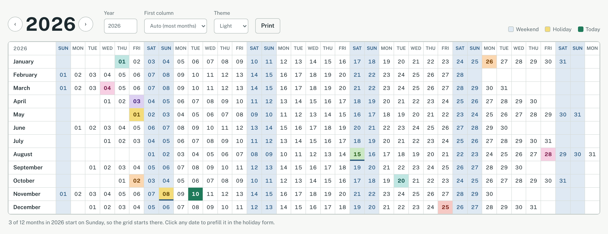
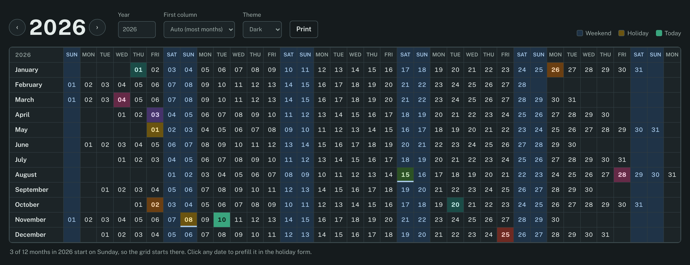
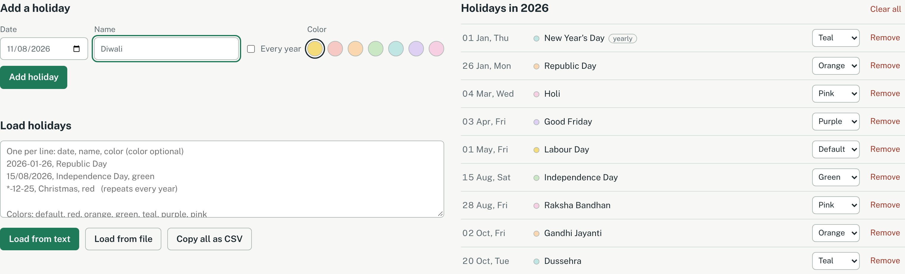

# Year Calendar

A single-page yearly calendar built with plain HTML, CSS and JavaScript. It lays out a whole year in a spreadsheet-style grid, with months as rows and a repeating weekday header across the top, and highlights weekends and holidays.

No frameworks, no build step, no server. Open the HTML file in a browser and it works.



## Layout

```
2026       SUN MON TUE WED THU FRI SAT SUN MON ...
January                     01  02  03  04  05 ...
February   01  02  03  04  05  06  07  08  09 ...
March      01  02  03  04  05  06  07  08  09 ...
...
```

Each month starts under the weekday its 1st falls on, so you can read any date's weekday straight from the column header.

## Features

- **Smart first column.** The grid starts on the weekday that the most months of the selected year begin on, so most rows line up at the left edge. For example, 2026 starts on Sunday (3 of 12 months), 2027 on Monday and 2028 on Saturday. A dropdown lets you force a specific start day instead.
- **Weekend highlighting.** Saturday and Sunday columns are tinted top to bottom, including empty cells, so weekends read as continuous stripes.
- **Holiday highlighting with colors.** Each holiday can use its own color: Default, Red, Orange, Green, Teal, Purple or Pink. Hovering a cell shows the holiday name. A holiday that falls on a weekend gets an extra marker so both states stay visible.
- **Today marker.** The current date gets its own solid fill. If today is also a holiday, the holiday color shows as a ring around it.
- **Year navigation.** Use the arrow buttons or type a year (1900 to 2200).
- **Light and dark mode.** The Theme dropdown switches between System (follows your OS setting), Light and Dark. Your choice is remembered.



- **Print view.** Prints only the calendar grid, with colors kept.

## Managing holidays



### Add one at a time

Pick a date, enter a name, choose a color and click **Add holiday**. Tick **Every year** for fixed-date holidays so they appear in every year you view. Clicking any date in the grid fills it into the form.

### Load in bulk

Paste into the text box and click **Load from text**, or use **Load from file** with a `.csv`, `.txt` or `.json` file.

CSV or plain text, one holiday per line, with an optional color as the last value:

```
2026-01-26, Republic Day
15/08/2026, Independence Day, green
02-10-2026, Gandhi Jayanti, orange
*-12-25, Christmas, red
```

Valid colors are `default`, `red`, `orange`, `green`, `teal`, `purple` and `pink`. Lines without a color use Default.

Accepted date formats:

| Format | Example | Meaning |
| --- | --- | --- |
| `YYYY-MM-DD` | `2026-01-26` | That date only |
| `DD/MM/YYYY` | `15/08/2026` | That date only |
| `DD-MM-YYYY` | `02-10-2026` | That date only |
| `*-MM-DD` | `*-12-25` | Every year |

Commas, tabs and semicolons all work as separators. A header line starting with `date` is skipped. Invalid dates and exact duplicates are skipped and counted in the result message.

JSON, either as an array:

```json
[
  { "date": "2026-01-26", "name": "Republic Day" },
  { "date": "*-12-25", "name": "Christmas", "color": "red" }
]
```

or as a simple date-to-name object:

```json
{ "2026-01-26": "Republic Day", "2026-08-15": "Independence Day" }
```

### Export, remove and clear

- **Copy all as CSV** copies every saved holiday in the CSV format above, colors included, ready to load elsewhere.
- The list beside the form shows the selected year's holidays. Each has a color dropdown to recolor it and a **Remove** button.
- **Clear all** removes every saved holiday across all years, after a confirmation.

## Storage

Holidays are saved in the browser's `localStorage` under the key `yearCalendarHolidays.v1`, and the theme choice under `yearCalendarTheme`. They persist between visits on the same browser and device, but they aren't shared across browsers or machines. Use **Copy all as CSV** to move them.

## Getting started

```bash
git clone https://github.com/<your-username>/<repo-name>.git
cd <repo-name>
```

Then open `year-calendar.html` in any modern browser.

### Hosting on GitHub Pages

1. Rename `year-calendar.html` to `index.html`, or add an `index.html` that links to it.
2. Push to GitHub.
3. In the repo, go to **Settings > Pages**, set the source to your main branch and root folder, and save.

The calendar will be live at `https://<your-username>.github.io/<repo-name>/`.

## Project structure

```
.
├── year-calendar.html       # Markup, styles and script in one file
├── README.md
└── docs/
    └── screenshots/         # Images used in this README
        ├── calendar-light.png
        ├── calendar-dark.png
        └── holidays.png
```

## Browser support

Works in current versions of Chrome, Edge, Firefox and Safari. The only external resource is the Public Sans font from Google Fonts, which falls back to system fonts when offline.

## License

Add your license of choice here (for example, MIT).
